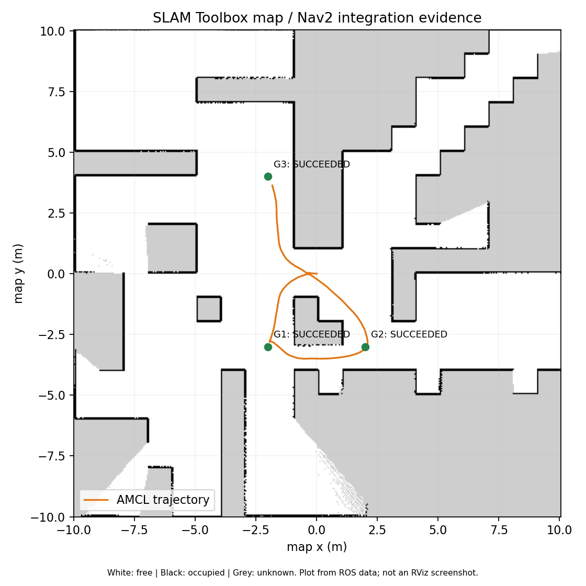
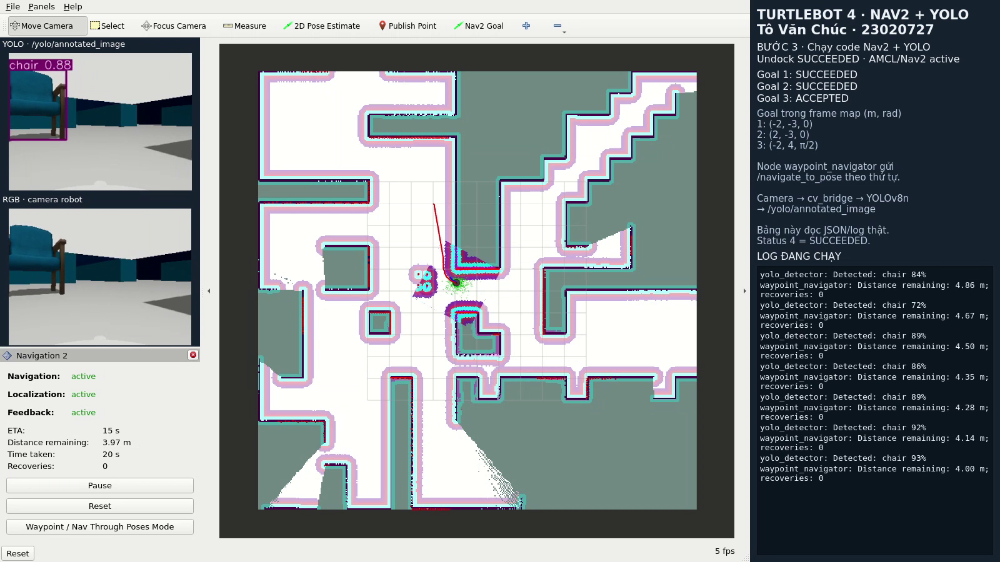
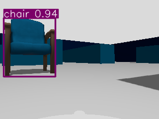

# TurtleBot 4: Navigation tự động và nhận diện YOLO

**Sinh viên: Tô Văn Chúc · MSSV: 23020727 · Lớp: [bổ sung].**
Ubuntu 22.04, ROS 2 Humble, Gazebo Fortress, TurtleBot 4 Lite, world maze.

## 1. Cấu trúc và luồng chương trình

Tái sử dụng map.yaml/map.pgm của bài tuần trước, không chạy SLAM khi localization.
Package turtlebot4_slam_nav gồm launch/config/map/RViz và hai node Python sinh viên:
waypoint_navigator.py điều khiển bằng action, yolo_detector.py nhận diện camera.
navigation.launch.py chạy simulation, map_server, AMCL và Nav2; autonomy.launch.py
chạy hai node sinh viên sau khi undock và kiểm tra định vị.

Luồng điều hướng: waypoints.yaml → PoseStamped trong map → action NavigateToPose
→ bt_navigator → NavFn global planner → DWB local controller → velocity_smoother
→ cmd_vel → Create 3. Node chờ AMCL/planner/controller/bt_navigator active, có
amcl_pose và TF map→base_link. Chỉ gửi goal tiếp theo sau kết quả SUCCEEDED.
Nếu reject/abort/timeout thì dừng chuỗi; Ctrl+C yêu cầu cancel và lưu JSON kết quả.
Không phát cmd_vel thủ công trong node sinh viên.

Luồng nhận diện chạy song song: camera RGB → sensor_msgs/Image → cv_bridge BGR8
→ YOLOv8n CPU → vẽ bounding box, class, confidence → ảnh annotation trên RViz
và JSON/log terminal. Cửa sổ camera PyQt đọc trực tiếp ảnh ROS trong video; bảng
trạng thái chỉ đọc JSON/log của node, không gửi lệnh robot. Worker giữ frame mới nhất, tối đa 3 FPS, ảnh inference 416 px,
confidence ≥ 0.4, giúp tránh hàng đợi ảnh cũ. Timestamp/frame_id được giữ từ camera.
YOLO chỉ quan sát; tránh vật cản thuộc Nav2/LiDAR. Bounding box pixel chưa phải vị trí map.

## 2. Node, topic và action chính

| Node/package | Chức năng và giao tiếp |
| --- | --- |
| Gazebo + ros_gz_bridge | Simulation, scan, odom, RGB, clock và TF |
| map_server + AMCL | Nạp map tĩnh, định vị bằng LiDAR/odometry, phát map→odom |
| robot_state_publisher / Create 3 | TF robot/sensor, odometry, thực thi vận tốc |
| planner_server / controller_server | NavFn tìm global path, DWB bám đường và tránh vật cản |
| bt_navigator / velocity_smoother | Điều phối action và làm mượt lệnh vận tốc |
| waypoint_navigator | Gửi tuần tự 3 NavigateToPose, nhận feedback/result, lưu kết quả |
| yolo_detector | Subscribe RGB, cv_bridge, YOLO, publish ảnh và log detection |

| Topic/action | Kiểu và ý nghĩa |
| --- | --- |
| /map; /scan; /odom | OccupancyGrid; LaserScan; Odometry |
| /initialpose; /amcl_pose | PoseWithCovarianceStamped: pose đầu và pose ước lượng |
| /tf; /tf_static; /clock | TFMessage và Clock: frame/thời gian mô phỏng |
| /clicked_point | PointStamped: khảo sát x/y trong map trước khi chạy |
| /navigate_to_pose | nav2_msgs/action/NavigateToPose: goal, feedback, result |
| /undock | irobot_create_msgs/action/Undock: rời dock trước navigation |
| /plan; /local_plan; /cmd_vel | Path toàn cục/local và Twist điều khiển robot |
| /oakd/rgb/preview/image_raw | sensor_msgs/Image từ camera RGB TurtleBot 4 |
| /yolo/annotated_image | sensor_msgs/Image có box/class/confidence |
| /yolo/detections | std_msgs/String: JSON header ảnh và danh sách detection |

## 3. Load map, AMCL và Nav2

Map cũ có 401×401 pixel, resolution 0.05 m/pixel, origin (-10,-10,0).
map_server đọc YAML và PGM, publish map với Transient Local; free_thresh 0.196
để pixel xám 205 vẫn là unknown. Dùng đúng maze/spawn như lần quét trước.
Dừng SLAM/teleop cũ, mở navigation.launch.py; RViz Fixed Frame = map.
Dùng 2D Pose Estimate đặt pose đầu đúng vị trí/hướng thực tế, undock, kiểm tra
LiDAR khớp tường và AMCL hội tụ. Undock trên máy này quay robot khoảng π rad;
nếu đặt initial pose sau undock phải dùng hướng hiện tại, không dùng yaw spawn 0.

AMCL dự đoán particles từ odometry, đánh giá LiDAR theo map, cập nhật trọng số và
resample để ước lượng pose. AMCL phát map→odom; odometry phát odom→base_link.
Các node simulation/AMCL/Nav2/YOLO dùng use_sim_time=true; riêng RViz của lượt video
dùng đồng hồ hiển thị wall time để tránh đứng khung hình. Timestamp ROS không bị sửa. Không dùng ground truth Gazebo thay cho AMCL.

NavFn dùng Dijkstra trên global costmap gồm map tĩnh, vật cản LiDAR và inflation;
allow_unknown=false. DWB lấy mẫu trajectory/vận tốc và chọn lệnh hợp lệ theo đường,
goal và vật cản gần robot. Local costmap cập nhật vật cản mới dù map tĩnh không đổi.
BT có replan/recovery khi cần. Tolerance goal là 0.25 m và 0.25 rad; action status
4 là SUCCEEDED, 5 CANCELED, 6 ABORTED. Acceptance chưa chứng minh đến đích.

## 4. Ba goal và thao tác chạy

Publish Point kết hợp ros2 topic echo /clicked_point cho x/y; yaw chọn theo hướng
cuối hoặc tính từ quaternion AMCL. Các điểm dưới đây tái sử dụng từ map đã kiểm thử,
được lưu trong config/waypoints.yaml (đơn vị m/rad, frame map):

| Goal | x | y | yaw | Khu vực |
| --- | --- | --- | --- | --- |
| 1 | -2.0 | -3.0 | 0.0 | Tây nam trung tâm |
| 2 | 2.0 | -3.0 | 0.0 | Đông nam trung tâm |
| 3 | -2.0 | 4.0 | 1.5708 | Hành lang bắc |

Quaternion goal: z=sin(yaw/2), w=cos(yaw/2), x=y=0. Sau khi node chạy không teleop
và không bấm Nav2 Goal. Hai lệnh chính: ros2 launch turtlebot4_slam_nav
navigation.launch.py, sau đó autonomy.launch.py với python_executable của venv và
đường dẫn weights yolov8n.pt. README chứa đầy đủ lệnh cài/build/chạy và kiểm tra.
Ghế tùy chọn là mesh/collision thật từ Gazebo Fuel, thêm bằng demo_objects.launch.py.
COCO có class chair; không có fire extinguisher, cần model khác nếu muốn nhận diện.

## 5. Kết quả, hình minh họa và giới hạn

Kiểm thử ngày 20/10/2026: build đạt, 5/5 kiểm thử ROS action đạt (thứ tự goal,
abort, timeout/cancel, thiếu localization và tọa độ không hợp lệ). Sau khi restart,
load map và undock, cả ba goal đều SUCCEEDED trong khi YOLO chạy song song:

| Goal | Action status | Thời gian thực |
| --- | --- | --- |
| 1 | 4 — SUCCEEDED | 64.581 s |
| 2 | 4 — SUCCEEDED | 66.982 s |
| 3 | 4 — SUCCEEDED | 132.916 s |

Lượt quan sát thu 1.030 ảnh RGB, 777 ảnh annotation; 154 khung hình có detection
nằm trong khoảng thực thi các goal. Ghế được nhận diện tới khoảng 94% confidence.
Không ghi nhận BUMP/CLIFF/STALL/WHEEL_DROP trong các goal; có 111 message BACKUP_LIMIT
(type 0), không tắt safety_override. Đây là giám sát hazard theo message, không phải
chứng minh hình học liên tục rằng mọi thời điểm đều không tiếp xúc vật cản.

YOLO đôi lúc gán nhãn sai như traffic light/person/bench/snowboard; không coi mọi
class dự đoán là ground truth. Lượt quay này dùng camera overlay 10 Hz, 2 luồng CPU
cho inference và cửa sổ RViz mới. Các lượt TF trễ/abort trước đó được giữ riêng,
không tính vào kết quả. Không kết luận đã xử lý dứt điểm mọi lỗi chạy lặp.

Video cục bộ TURTLEBOT4_NAV2_YOLO_DEMO.mp4 dài khoảng 5 phút 54 giây, ghi liên tục
1600×900, 8 FPS: nạp map → initial pose/AMCL → undock → ba goal bằng code, đồng thời
có camera YOLO và log thật. MP4 chỉ chuyển định dạng từ bản WebM; không ghép các
lượt chạy. Đối chiếu dữ liệu cùng lượt trong artifacts/autonomy_video_clean/:
setup.json, waypoints.json, telemetry.json, validation.json và video_info.json.

## 6. Link nộp bài và tài liệu

- Video Google Drive công khai: **[chờ upload và điền link]**.
- Repository GitHub Public: **[chờ publish và điền link]**.
- [TurtleBot 4 Navigator](https://turtlebot.github.io/turtlebot4-user-manual/tutorials/turtlebot4_navigator.html)
- [Nav2 Simple Commander source Humble](https://github.com/ros-navigation/navigation2/blob/humble/nav2_simple_commander/nav2_simple_commander/robot_navigator.py)
- [Ultralytics predict](https://docs.ultralytics.com/modes/predict/)

PDF còn là bản nháp cho tới khi điền lớp và hai link công khai. Video cục bộ đã
được đối chiếu đủ localization → ba goal bằng code → YOLO song song. Sinh viên cần giải thích
được quaternion, TF, AMCL, action feedback/result, costmap và cv_bridge/YOLO.
