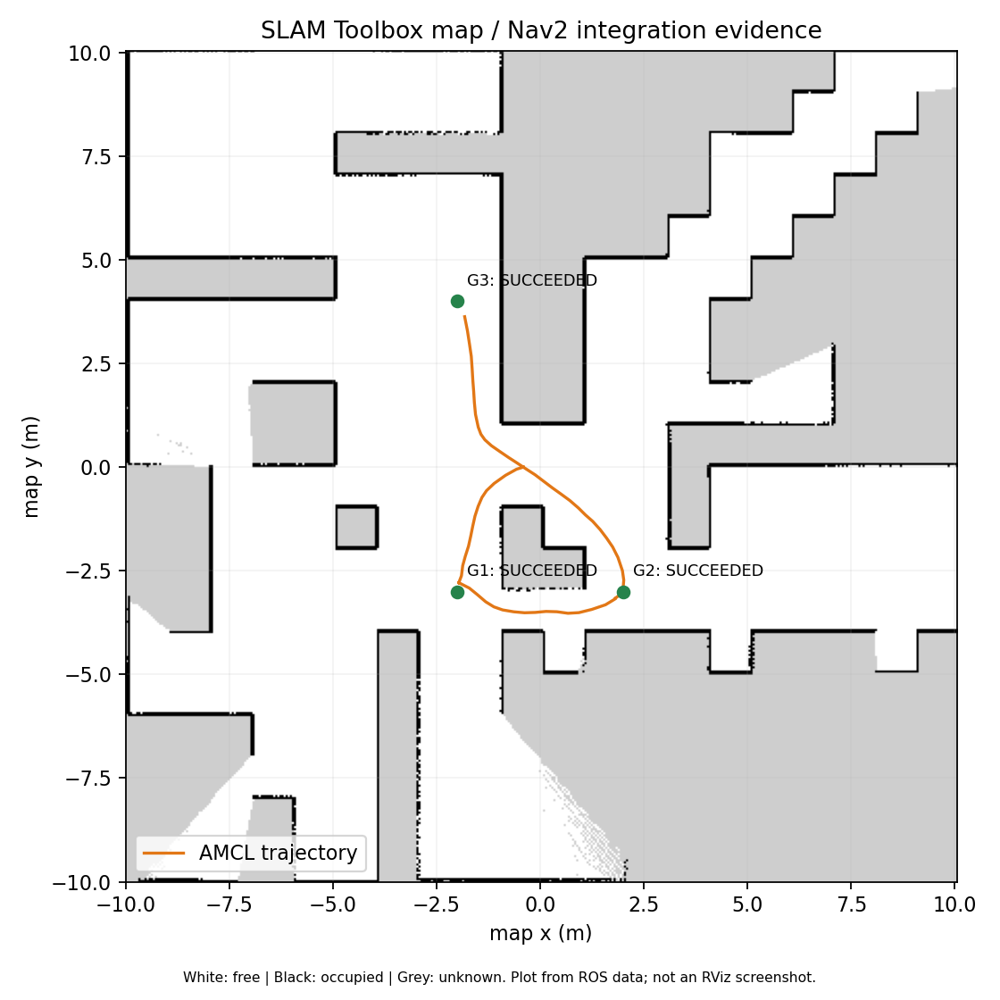

# BÁO CÁO THỰC HÀNH TURTLEBOT 4
**Xây dựng bản đồ bằng SLAM Toolbox, localization và navigation với Nav2**

| Thông tin | Nội dung |
| --- | --- |
| Họ và tên | [Điền họ và tên] |
| Mã số sinh viên | [Điền MSSV] |
| Lớp / học phần | [Điền lớp và học phần] |
| Giảng viên | [Điền tên giảng viên] |
| Ngày kiểm thử | 13/10/2026 |

## 1. Mục tiêu và môi trường thực hiện
Thực hành sử dụng TurtleBot 4 trong Gazebo để thu thập dữ liệu LiDAR, xây dựng bản đồ, lưu bản đồ, khởi động lại môi trường và định vị robot trên bản đồ đã tạo. Sau đó sử dụng Nav2 để robot tự lập kế hoạch và di chuyển đến các vị trí khác nhau.

Môi trường kiểm thử: Ubuntu 22.04, ROS 2 Humble, Gazebo Fortress 6.18.0, TurtleBot 4 Lite và world `maze` có sẵn trong simulator chính thức. Robot, bộ điều khiển và bridge sử dụng các package TurtleBot 4 có sẵn.

Kết quả đã kiểm chứng: tạo bản đồ từ SLAM Toolbox, lưu/load bản đồ, chạy AMCL sau khi khởi động lại và hoàn thành ba goal Nav2 với trạng thái **SUCCEEDED**. Các goal được gửi bằng action trong kiểm thử; phần video teleoperation và thao tác Nav2 Goal trên RViz còn cần bổ sung.

## 2. Cấu trúc chương trình
Package `turtlebot4_slam_nav` tổ chức launch, cấu hình và dữ liệu bản đồ riêng để có thể chạy lại thí nghiệm.

| Thành phần | Chức năng |
| --- | --- |
| `launch/simulation.launch.py` | Mở Gazebo, world maze, spawn robot/dock, chạy bridge thời gian và RViz. |
| `launch/mapping.launch.py` | Khởi chạy simulator và SLAM Toolbox synchronous. |
| `launch/localization.launch.py` | Load bản đồ và khởi chạy map_server, AMCL. |
| `launch/navigation.launch.py` | Khởi chạy localization và hệ thống Nav2. |
| `config/`, `rviz/` | Tham số SLAM, AMCL, Nav2, DDS và cấu hình hiển thị. |
| `maps/map.yaml`, `maps/map.pgm` | Metadata và ảnh occupancy map đã lưu. |
| `scripts/`, `tools/` | Kiểm tra sensor/TF, lưu map, thiết lập môi trường và kiểm thử. |
| `docs/`, `artifacts/` | Báo cáo, checklist demo, log và số liệu kết quả. |

Pipeline chính: **Gazebo → LiDAR/odometry/TF → SLAM → bản đồ → map_server + AMCL → Nav2 → lệnh vận tốc → TurtleBot 4.**

<!-- PAGEBREAK -->
## 3. Các node, package và topic chính

| Node / package | Vai trò |
| --- | --- |
| Gazebo, `turtlebot4_ignition_bringup` | Mô phỏng world, robot và sensor; dùng launch chính thức. |
| `ros_gz_bridge`, `robot_state_publisher` | Bridge Gazebo–ROS và phát TF giữa các link robot. |
| `irobot_create_nodes` | Undock, nhận lệnh vận tốc và xử lý phản xạ an toàn Create 3. |
| `slam_toolbox` | Scan matching, pose graph, loop closure và xây dựng bản đồ. |
| `map_server`, `amcl` | Load map cố định và định vị bằng particle filter. |
| `planner_server`, `controller_server` | Tìm đường toàn cục và chọn vận tốc bám đường. |
| `bt_navigator`, `behavior_server` | Điều phối navigation và các hành vi recovery. |
| `velocity_smoother`, `lifecycle_manager` | Làm mượt vận tốc; configure/activate các node. |
| `rviz2`, `nav2_rviz_plugins` | Hiển thị map, robot, scan, đường đi; đặt pose và goal. |

| Topic / action | Kiểu message / action | Chức năng |
| --- | --- | --- |
| `/scan` | `sensor_msgs/LaserScan` | Khoảng cách LiDAR. |
| `/odom` | `nav_msgs/Odometry` | Pose và vận tốc trong odom. |
| `/cmd_vel` | `geometry_msgs/Twist` | Vận tốc gửi tới robot. |
| `/cmd_vel_nav` | `geometry_msgs/Twist` | Vận tốc Nav2 trước khi làm mượt. |
| `/map` | `nav_msgs/OccupancyGrid` | Lưới bản đồ: unknown/free/occupied. |
| `/tf`, `/tf_static` | `tf2_msgs/TFMessage` | Biến đổi giữa các frame. |
| `/clock` | `rosgraph_msgs/Clock` | Thời gian mô phỏng. |
| `/initialpose`, `/amcl_pose` | `geometry_msgs/PoseWithCovarianceStamped` | Pose khởi tạo và pose AMCL ước lượng. |
| `/particle_cloud` | `nav2_msgs/ParticleCloud` | Các giả thuyết pose của AMCL. |
| `/plan`, `/local_plan` | `nav_msgs/Path` | Đường toàn cục và đường local. |
| `/global_costmap/costmap`, `/local_costmap/costmap` | `nav_msgs/OccupancyGrid` | Lưới chi phí phục vụ tránh vật cản. |
| `/undock` | `irobot_create_msgs/action/Undock` | Rời dock. |
| `/navigate_to_pose` | `nav2_msgs/action/NavigateToPose` | Gửi goal và nhận kết quả navigation. |

Chuỗi TF chính: **map → odom → base_link → rplidar_link**. SLAM phát `map → odom` khi mapping; AMCL đảm nhiệm biến đổi này khi localization. Hai chế độ không chạy đồng thời. Tất cả node sử dụng `use_sim_time=true` để đồng bộ timestamp với Gazebo.

<!-- PAGEBREAK -->
## 4. Xây dựng và lưu bản đồ
Khởi chạy `mapping.launch.py`, kiểm tra `/scan`, `/odom`, `/clock` và TF, sau đó thực hiện undock. Quy trình demo yêu cầu điều khiển bằng teleoperation qua các hành lang, quay quan sát tường/vật cản và đi lại các vùng cũ để tạo cơ hội loop closure; theo dõi bản đồ liên tục trên RViz.

Trong SLAM Toolbox, odometry cung cấp dự đoán chuyển động. Scan matching dùng LiDAR để hiệu chỉnh pose. Các pose và ràng buộc tương đối tạo thành pose graph; khi nhận ra vùng đã đi, loop closure bổ sung ràng buộc và tối ưu graph nhằm giảm drift. Các scan đã gắn pose được tích hợp thành occupancy grid.

Trong lần kiểm thử đã ghi log, robot được khảo sát bằng script phát lệnh vận tốc qua nhiều nhánh maze. Bản đồ thu được là kết quả SLAM thật. Quy trình này kiểm tra hoạt động của pipeline; video khảo sát bằng bàn phím vẫn cần thực hiện theo đề bài.

| Thuộc tính bản đồ | Giá trị |
| --- | --- |
| Kích thước / độ phân giải | 401 × 401 pixel / 0,05 m mỗi pixel |
| Origin trong frame map | (-10, -10, 0) |
| Mode / occupied threshold / free threshold | trinary / 0,65 / 0,196 |
| Ô unknown / free / occupied | 67.189 / 88.298 / 5.314 |
| Vùng sàn trống đã quan sát | Khoảng 76,8%, ước lượng theo world maze |

`map_saver_cli` lưu `/map` thành `map.pgm` và `map.yaml`. YAML chứa đường dẫn ảnh, resolution, origin và các ngưỡng phân loại. Dùng free threshold 0,196 để pixel xám 205 tiếp tục được đọc là unknown sau khi load lại. Kiểm tra save/load cho kết quả số ô unknown/free/occupied giữ nguyên.

Quan sát chất lượng trên RViz: vùng trắng là trống, đen là vật cản, xám là chưa quan sát. Cần kiểm tra tường kép, hành lang lệch và các vùng chưa khảo sát. Bản đồ hiện còn vùng unknown ở một số nhánh; cần khảo sát thêm để hoàn thiện demo.

## 5. Localization sau khi khởi động lại
Dừng SLAM và simulator; khởi động lại đúng world, model và vị trí spawn. Chạy `localization.launch.py` hoặc `navigation.launch.py` với bản đồ đã lưu. map_server cung cấp bản đồ cố định; AMCL dùng odometry để dự đoán particle, so sánh LiDAR với map để cập nhật trọng số rồi resample và ước lượng pose.

Dùng **2D Pose Estimate** trên RViz để đặt vị trí và hướng gần thực tế. Trong lần kiểm thử, undock làm robot quay khoảng π rad, nên initial pose sau undock đặt gần (-0,3; 0; π). Kiểm tra laser trùng tường, robot trên map tương ứng với Gazebo và pose ổn định khi di chuyển. AMCL phát `map → odom`; odom liên tục nhưng có drift, còn map cung cấp tham chiếu theo bản đồ.

Sai lệch localization ban đầu so với Gazebo khoảng **0,050 m và 0,009 rad**. Ground truth chỉ được đọc để đối chiếu kết quả, không dùng để điều khiển robot hoặc thay cho AMCL.

<!-- PAGEBREAK -->
## 6. Navigation với Nav2
Khi đặt **Nav2 Goal** trên RViz, plugin gửi action `NavigateToPose`. bt_navigator điều phối behavior tree: yêu cầu planner_server tìm đường toàn cục, sau đó controller_server bám đường, kiểm tra tiến trình và điều kiện đạt đích. Khi cần, hệ thống tự replan hoặc chạy các hành vi recovery như clear costmap, spin, backup và wait.

Global costmap kết hợp map tĩnh, vật cản từ LiDAR và inflation. NavFn dùng Dijkstra (`use_astar=false`) để tìm đường trên lưới chi phí. `allow_unknown=false` hạn chế lập đường qua vùng chưa khảo sát.

Local costmap cập nhật vật cản quanh robot trong frame odom. DWB lấy mẫu các vận tốc, mô phỏng trajectory ngắn hạn và chấm điểm theo vật cản, đường toàn cục, khoảng cách/hướng tới goal và dao động. Lệnh được chọn đi qua velocity_smoother rồi tới `/cmd_vel` để điều khiển Create 3.

| Tham số chính | Giá trị |
| --- | --- |
| Planner / controller | NavFn (Dijkstra) / DWB |
| Robot radius / inflation radius | 0,19 m / 0,45 m |
| Vận tốc tiến tối đa | 0,26 m/s |
| Dung sai vị trí / hướng tại goal | 0,25 m / 0,25 rad |

## 7. Kết quả kiểm thử navigation
Sau khi load map, các node AMCL, planner_server, controller_server và bt_navigator đều ở trạng thái active. Ba goal nằm tại các khu vực khác nhau và đều kết thúc với action status 4 (**SUCCEEDED**). Script kiểm thử chỉ gửi initialpose và action; không phát `/cmd_vel` trong khi robot thực hiện goal.

| Goal (x, y, yaw) | Kết quả | Sai số vị trí tới goal (m) | AMCL lệch Gazebo (m) | Thời gian thực (s) |
| --- | --- | --- | --- | --- |
| G1: (-2, -3, 0) | SUCCEEDED | 0,21636 | 0,06738 | 48,9 |
| G2: (2, -3, 0) | SUCCEEDED | 0,24986 | 0,02032 | 53,6 |
| G3: (-2, 4, π/2) | SUCCEEDED | 0,23508 | 0,05640 | 107,3 |

Sai số vị trí và hướng của cả ba goal nằm trong dung sai cấu hình. Goal 2 có sai số sát ngưỡng 0,25 m; số liệu gốc là 0,249861 m. Kết quả SUCCEEDED không yêu cầu tâm robot trùng tuyệt đối tọa độ goal.

Không ghi nhận BUMP, CLIFF, STALL hoặc WHEEL_DROP trong ba goal. Có BACKUP_LIMIT sau undock ở giai đoạn đầu goal 1; sự kiện này không phải BUMP. Đối chiếu 143 mẫu ground truth cho khoảng cách nhỏ nhất từ tâm robot đến tường khoảng 0,431 m. Đây là kiểm tra lấy mẫu; video quan sát liên tục vẫn cần bổ sung.

Các số liệu lấy từ `artifacts/navigation_results.json`, `navigation_validation.json`, `map_roundtrip_check.json` và `map_coverage.json`. Các goal đã kiểm thử bằng action; cần quay thêm thao tác đặt ba goal bằng công cụ Nav2 Goal trên RViz theo yêu cầu đề bài.

<!-- PAGEBREAK -->
## 8. Hình ảnh minh họa kết quả

**Hình 1.** Bản đồ occupancy và đường đi của G1, G2, G3, vẽ từ map.pgm và dữ liệu ROS thực tế. Đây là hình tổng hợp dữ liệu, không phải ảnh chụp màn hình RViz. Các vùng xám biểu thị khu vực chưa được quan sát.

Hình thể hiện bản đồ đã tạo và các tuyến navigation tại nhiều khu vực. Khi thực hiện video, cần ghi thêm màn hình Gazebo/RViz ở các bước: khảo sát bằng teleop, toàn bộ bản đồ, load lại map, đặt initial pose và hoàn thành ba goal.

## 9. Tình trạng hoàn thiện bài nộp
Source, launch/config, README, map.yaml, map.pgm, log kiểm thử và báo cáo đã được chuẩn bị. Build package thành công; kiểm tra sensor/TF, load map và ba action Nav2 đã đạt.

Các nội dung cần bổ sung trước khi nộp cuối cùng: thông tin sinh viên; video mapping bằng teleoperation và ba goal qua RViz; link Google Drive công khai; link repository GitHub Public; câu hỏi đúng nguyên văn trong phần “Nội dung cần hiểu” của giảng viên. Đề được cung cấp hiện chưa kèm danh sách câu hỏi đó.

<!-- PAGEBREAK -->
## 10. Các câu hỏi kiến thức cần hiểu
Các câu dưới đây phục vụ ôn tập và giải thích chương trình; cần đối chiếu, bổ sung theo danh sách câu hỏi chính thức của giảng viên.

**1. SLAM và localization khác nhau như thế nào?** SLAM đồng thời ước lượng pose và tạo/cập nhật bản đồ. Localization ước lượng pose trên bản đồ đã có; trong bài này AMCL sử dụng map cố định.

**2. Vì sao chỉ odometry chưa đủ?** Sai số chuyển động tích lũy gây drift. LiDAR, scan matching và loop closure cung cấp ràng buộc để hiệu chỉnh sai số.

**3. Vì sao cần TF và use_sim_time?** Scan, odometry và goal ở các frame khác nhau. TF chuyển dữ liệu về cùng hệ tại đúng timestamp; use_sim_time giúp các node dùng cùng thời gian Gazebo, tránh lỗi extrapolation và timeout.

**4. Map khác costmap như thế nào?** Map lưu occupancy của môi trường. Costmap kết hợp map, vật cản hiện tại, kích thước robot và inflation để phục vụ lập kế hoạch và điều khiển.

**5. Global planner khác local controller thế nào?** Global planner tìm tuyến đi dài tới goal. Local controller chọn vận tốc khả thi để bám tuyến, đồng thời tránh vật cản gần robot.

**6. AMCL xác định vị trí robot như thế nào?** Particle biểu diễn các giả thuyết pose. Odometry dự đoán chuyển động; độ khớp LiDAR với bản đồ quyết định trọng số. Resampling tập trung các particle vào vùng pose có xác suất cao.

**7. Robot xử lý vật cản mới như thế nào?** LiDAR cập nhật obstacle layer của costmap. Nav2 có thể đổi vận tốc, lập lại đường hoặc recovery; map tĩnh dùng cho AMCL không cần được xây dựng lại trong mỗi goal.

**8. PGM và YAML có đủ để tiếp tục SLAM không?** Hai file đủ để map_server load bản đồ và AMCL localization. Muốn tiếp tục tối ưu SLAM cần lưu/khôi phục pose graph và dữ liệu SLAM tương ứng.

**9. Khi nào có thể kết luận navigation thành công?** Action trả SUCCEEDED, robot đạt dung sai vị trí/hướng và có bằng chứng di chuyển an toàn. Goal được chấp nhận chưa chứng minh robot đã đến đích.

## 11. Liên kết nộp bài và tài liệu tham khảo
- Video Google Drive, chế độ công khai: **[Điền link video sau khi upload]**.
- GitHub repository, chế độ Public: **[Điền link repository sau khi đăng bài]**.
- [TurtleBot 4 Simulator – tài liệu chính thức](https://turtlebot.github.io/turtlebot4-user-manual/software/turtlebot4_simulator.html).
- [TurtleBot 4 Navigation – tài liệu chính thức](https://turtlebot.github.io/turtlebot4-user-manual/tutorials/navigation.html).
- [SLAM Toolbox – mã nguồn và tài liệu](https://github.com/SteveMacenski/slam_toolbox).
- [Nav2 – tài liệu chính thức](https://docs.nav2.org/).

Lệnh chạy, cấu hình và cách tái hiện được trình bày trong README của package. Báo cáo ghi đúng kết quả kiểm thử hiện có; các liên kết và bằng chứng video sẽ được cập nhật sau khi hoàn thành.
